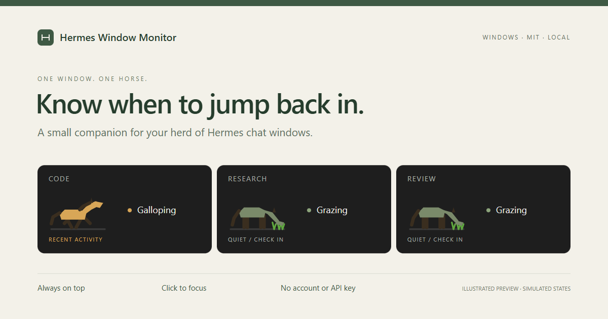

<p align="center">
  
</p>

# Hermes Window Monitor

**一眼看到，哪匹马需要你。**

给同时运行多个 [Hermes](https://github.com/NousResearch/hermes-agent)
会话的 Windows 用户准备的一条常驻置顶小马栏。
每个经典控制台窗口对应一匹马：后台进程活跃时奔跑，安静时吃草。
点击小马，就能回到它对应的终端。

[English](README.md) · [快速开始](#快速开始) ·
[工作原理](docs/architecture.md) · [反馈问题](https://github.com/RollinsLy/hermes-window-monitor/issues/new/choose)


## 少切几次窗口，及时接上下一轮

几个 Agent 分别在不同终端里工作时，很容易忘记哪个还在忙、哪个已经安静下来。
小马栏把每个窗口的活动线索放在屏幕角落，不用读取对话，也不需要接入模型 API。

| 看到什么 | 表示什么 | 可以做什么 |
| --- | --- | --- |
| 小马奔跑 | 近期检测到后台会话有 CPU 活动 | 让它继续工作 |
| 小马吃草 | 近期未检测到活动 | 看看是否需要你的输入 |
| 鼠标悬停 | Profile、窗口标题、进程 ID、推断状态 | 分辨不同会话 |
| 点击小马 | 恢复并聚焦对应终端 | 回到对话 |

**这是活动推断，不是任务完成通知。** 等待模型或网络响应、进程卡住，也可能表现为低 CPU。
为减少输入和界面重绘带来的误报，前台终端不会刷新活动计时，因此前台会话也可能显示吃草。

## 快速开始

需要 Windows、带 Tkinter 的 CPython，以及 `psutil`。
推荐 Python 3.10+；CI 检查 3.10 和 3.13，源码语法兼容 Python 3.8。
实时监控要求 Hermes 位于**独立的经典控制台窗口**（`ConsoleWindowClass`）。
当前扫描方式不支持 Windows Terminal 标签页和 IDE 内置终端。

```powershell
git clone https://github.com/RollinsLy/hermes-window-monitor.git
cd hermes-window-monitor
python -m venv .venv
.\.venv\Scripts\python.exe -m pip install -r requirements.txt
.\.venv\Scripts\python.exe hermes_monitor.py --demo
```

演示模式无需运行 Hermes，使用三个明确标注为 **DEMO** 的模拟会话展示真实小马组件，
每六秒切换一次活动窗口。它不会扫描真实进程，也不会切换你的窗口。点击 **×** 退出。

去掉 `--demo` 即进入实际监控：

```powershell
.\.venv\Scripts\python.exe hermes_monitor.py
```

在支持的控制台中启动 Hermes 后，对应小马会自动出现。
拖动左侧 **≡** 移动小马栏；关闭小马栏不会终止 Hermes。

不想显示额外控制台，可以运行：

```powershell
.\.venv\Scripts\pythonw.exe hermes_monitor.py
```

如果 PATH 中的 `pythonw` 已安装依赖，也可以双击 `run.bat`。
使用上面的完整虚拟环境路径，可以避免装依赖和运行时用了不同解释器。

## 为什么按窗口分马？

一个 Hermes 会话可能包含原生启动器、Python 环境转发层和真正工作的进程。
监控器沿父进程链找到所属终端，再按窗口句柄归组，避免同一个会话出现好几匹马。
同一 Profile 打开的两个窗口，仍然各有一匹马；悬停或点击即可区分。

Hermes 在中文社区常被叫作“爱马仕”，同时开多个会话就成了“养马”，
所以这里真的给你养了一排马。

## 数据留在本机

监控器不需要账号、API Key 或网络服务，只在本机读取进程元数据、CPU 活动和窗口标题，
用 Windows API 查找及聚焦窗口。它不读取聊天记录或终端正文。
命令行参数和窗口标题仍可能包含隐私，分享截图前请脱敏。详见 [安全说明](SECURITY.md)。

## 常见问题

| 问题 | 排查方法 |
| --- | --- |
| 找不到 `psutil` | 用启动程序的同一个 Python 安装 `requirements.txt`。 |
| 显示 `no hermes windows` | 先试 `--demo`，再确认使用经典控制台。Windows Terminal 标签页、IDE 终端、WSL 和远程会话不在当前支持范围。 |
| 明明还在工作，却显示吃草 | CPU 只是活动线索；等待网络和前台操作都可能显示为空闲。 |
| 点击无法切换窗口 | 尽量让 Hermes 和监控器使用相同权限；Windows 本身也可能限制前台切换。 |
| Profile 名称重复 | 不同窗口可以使用同一个 Profile。悬停看标题，或点击定位。 |
| 双击后没有反应 | 用 `python` 在终端中运行以查看错误，检查 Tkinter 和依赖。 |

## 调整外观和灵敏度

修改 `hermes_monitor.py` 顶部常量后重新运行：

| 常量 | 默认值 | 用途 |
| --- | --- | --- |
| `CPU_ACTIVE_THRESHOLD` | `2.0` | 判定活动的 CPU 百分比阈值 |
| `IDLE_SECONDS` | `3.0` | 活动状态保留秒数 |
| `SCAN_INTERVAL_MS` | `1000` | 进程扫描与 CPU 采样间隔 |
| `ANIM_INTERVAL_MS` | `80` | 动画刷新间隔 |
| `HORSE_SCALE` | `1.0` | 小马尺寸 |
| `RUN_CYCLE_FRAMES` | `8` | 奔跑周期帧数 |
| `GRAZE_CYCLE_FRAMES` | `40` | 吃草周期帧数 |

同一位置还可修改小马、草地、背景与文字颜色。

## 一起改进

```powershell
python -m unittest discover -s tests -v
```

欢迎提交终端兼容性实测、启动方式的回归用例、中英文说明改进，
或讨论更可靠的活动信号。当前项目仍处于早期阶段；更广泛的终端支持属于后续方向。

[贡献指南](CONTRIBUTING.md) · [工作原理与限制](docs/architecture.md) · [更新记录](CHANGELOG.md)

[MIT 开源许可](LICENSE) · [RollinsLy](https://github.com/RollinsLy) 维护。
这是独立社区工具，并非 Hermes、Nous Research 或 OpenAI 官方产品。
